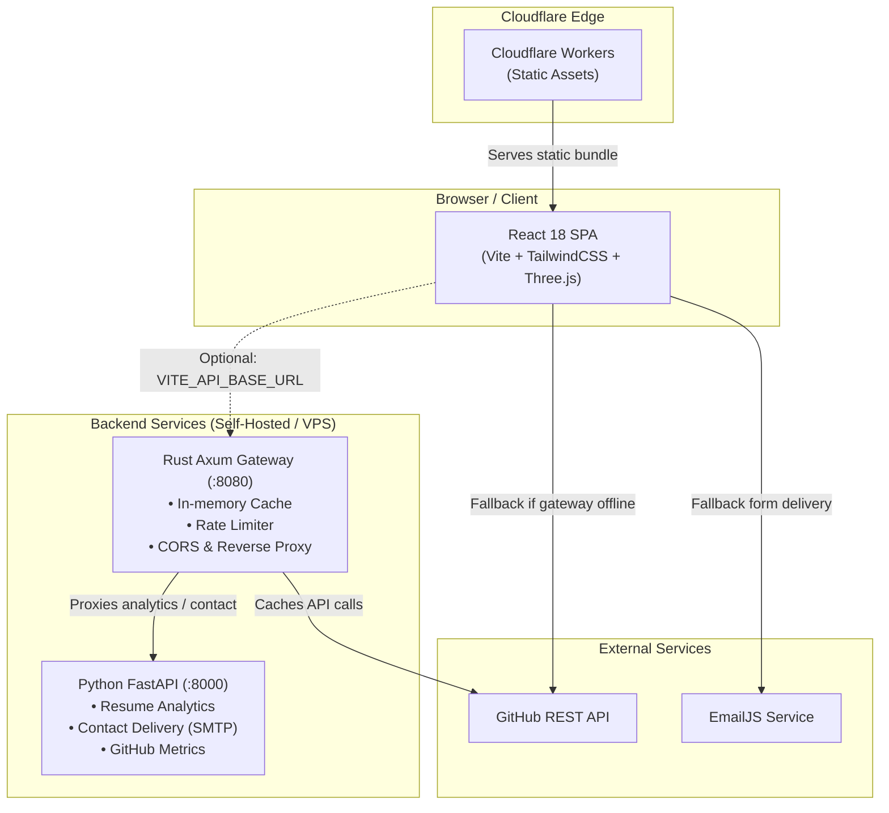

# 🚀 Tanish Jaswal — Portfolio

[](https://tanishjaswal.tech)
[](https://github.com/WARRIORXR/portfolio)
[](https://react.dev)
[](https://tailwindcss.com)
[](https://tanishjaswal.tech)

> **AI/ML & Computer Science Student** · Python Developer · Machine Learning · Deep Learning · Full-Stack Systems

🌐 **Live Site:** [https://tanishjaswal.tech/](https://tanishjaswal.tech/) *(Preview: [https://tanish-portfolio.tanishjaswal56.workers.dev/](https://tanish-portfolio.tanishjaswal56.workers.dev/))*

A modern, high-performance portfolio featuring an interactive **Three.js / 3D Skyline**, animated glassmorphism cards, dynamic GitHub insights, PWA offline capabilities, and a decoupled architecture deployed on **Cloudflare Workers**.

---

## ✨ Features

- **Glassmorphism UI** — backdrop-blur glass panels, refined dark mode palettes, gradient glowing borders.
- **3D Contribution Skyline** — Three.js & Canvas-powered 3D visualization of GitHub contributions.
- **Dynamic GitHub Insights** — auto-fetches repositories, language distributions, and commit streaks from GitHub (`WARRIORXR`).
- **Smooth Animations** — Framer Motion scroll reveals, GSAP transitions, and interactive tilt effects.
- **Dual-Mode Architecture** — runs standalone as an ultra-fast static SPA on Cloudflare edge, with graceful fallback if the backend gateway is offline.
- **Full-Stack API Gateway** — high-throughput Rust Axum gateway (`backend/rust-api`) providing caching, CORS control, and rate limiting.
- **Python Analytics Service** — FastAPI backend (`backend/py-service`) performing resume/skill aggregation, analytics, and contact messaging.
- **Contact Handling** — validated form submission supporting both direct EmailJS delivery and server-side SMTP / queue processing.
- **PWA Ready** — installable progressive web app with service worker caching via `vite-plugin-pwa`.
- **Security Hardened** — HTTP security headers (`_headers`) enforcing strict CSP, frame options, and referrer policies.
- **Cloudflare Agent & MCP Ready** — configured with Model Context Protocol (MCP) server endpoints and official Cloudflare skill integration.

---

## 🛠️ Tech Stack

| Layer | Technologies |
|---|---|
| **Frontend** | React 18, Vite 5, TypeScript / JSX, TailwindCSS 3 |
| **Animation & 3D** | Three.js, Framer Motion 11, GSAP, React Tilt, React Type Animation |
| **Hosting & CDN** | Cloudflare Workers (Static Assets with SPA routing) |
| **Edge Tooling** | Cloudflare Wrangler v4, Model Context Protocol (MCP) |
| **API Gateway (Optional)** | Rust, Axum, Tokio, Tower-HTTP (`backend/rust-api`) |
| **Data Service (Optional)**| Python 3, FastAPI, Uvicorn, Pytest (`backend/py-service`) |
| **PWA & Icons** | Vite PWA, Lucide React, React Icons |
| **Notifications** | React Hot Toast |

---

## 🧱 Architecture



- **Compile-time profile**: Common resume data, skills, and metrics live in [`shared/profile.json`](shared/profile.json) and are shared across frontend, Rust, and Python layers.
- For complete backend API documentation, endpoints, and data contracts, see **[backend/README.md](backend/README.md)**.

---

## 🚦 Getting Started

### Prerequisites
- Node.js 18+ and npm
- *(Optional for backend)* Rust toolchain (`cargo`) and Python 3.10+

### 1. Clone & Install
```bash
git clone https://github.com/WARRIORXR/portfolio.git
cd portfolio
npm install
```

### 2. Environment Configuration
Create a `.env` file based on `.env.example`:
```bash
cp .env.example .env
```

Configure your environment variables:
```env
# Frontend
VITE_GITHUB_USERNAME=WARRIORXR
VITE_EMAILJS_SERVICE_ID=your_emailjs_service_id
VITE_EMAILJS_TEMPLATE_ID=your_emailjs_template_id
VITE_EMAILJS_PUBLIC_KEY=your_emailjs_public_key

# Optional: set when running the backend gateway locally
VITE_API_BASE_URL=http://127.0.0.1:8080
```

### 3. Run Development Server
```bash
# Frontend only (standalone mode)
npm run dev
```
Open `http://localhost:5173` in your browser.

---

## 💻 Full-Stack Development (Optional)

To run the complete system with the local Rust gateway and Python analytics service:

```bash
# 1. Setup Python virtual environment & install requirements
npm run setup:py

# 2. Start the Python data service (port 8000)
npm run dev:py

# 3. Start the Rust API gateway (port 8080)
npm run dev:api

# 4. Start frontend connected to gateway
npm run dev
```

---

## 📜 Available Scripts

| Command | Description |
|---|---|
| `npm run dev` | Starts Vite local development server |
| `npm run build` | Builds optimized production bundle into `dist/` |
| `npm run preview` | Previews the production build locally |
| `npm run deploy` | Builds and deploys the project to **Cloudflare Workers** |
| `npm run deploy:preview` | Builds and performs a dry-run check with Wrangler |
| `npm run lint` | Runs ESLint analysis |
| `npm run check:api` | Runs `cargo check` on the Rust gateway |
| `npm run dev:api` | Runs the Rust Axum API gateway |
| `npm run setup:py` | Sets up Python virtualenv and dependencies |
| `npm run dev:py` | Starts the Python FastAPI service with hot reloading |
| `npm run test:py` | Runs tests on the Python service using pytest |

---

## 📁 Project Structure

```
portfolio/
├── .vscode/
│   └── mcp.json                # Cloudflare Model Context Protocol (MCP) config
├── backend/
│   ├── py-service/             # FastAPI: analytics, GitHub streaks & contact delivery
│   ├── rust-api/               # Axum gateway: /api/*, rate limiting, caching & proxy
│   └── README.md               # Backend architecture & API specifications
├── public/
│   ├── _headers                # Cloudflare HTTP security & caching headers
│   ├── favicon.svg             # Portfolio favicon
│   ├── manifest.json           # Progressive Web App manifest
│   └── Tanish_Jaswal_Data_Analyst_Resume.pdf
├── scripts/                    # Platform scripts for Python setup & checks
├── shared/
│   └── profile.json            # Shared source of truth (resume, skills, projects)
├── src/
│   ├── components/
│   │   ├── layout/             # Navbar, Footer
│   │   ├── sections/           # About, Skills, Projects, Contact
│   │   ├── shared/             # ErrorBoundary, ScrollProgress, SectionWrapper, Loading
│   │   └── ui/                 # 3D Skyline, ProjectShowcase, BrandIcons
│   ├── data/
│   │   ├── personalInfo.js     # Personal bio & contact details
│   │   └── skills.js           # Tech skills & project definitions
│   ├── hooks/
│   │   ├── useGithubContributions.js
│   │   └── useGithubRepos.js
│   ├── lib/
│   │   ├── api.js              # Rust API client with automatic fallback
│   │   ├── emailjs.js          # Contact submission handler (API / EmailJS)
│   │   ├── github.js           # GitHub data fetcher with local storage cache
│   │   ├── links.js            # External URLs & social navigation
│   │   └── utils.ts            # UI utilities & className merger
│   ├── App.jsx                 # Application layout root
│   ├── index.css               # Tailwind CSS & global animations
│   └── main.jsx                # React DOM entry point
├── AGENTS.md                   # AI Agent guidance & deployment contracts
├── wrangler.toml               # Cloudflare Workers & assets deployment configuration
├── vite.config.js              # Vite build, PWA & chunk splitting setup
└── package.json
```

---

## 🌐 Cloudflare Deployment

The application is deployed on **Cloudflare** using Wrangler static asset hosting with Single Page Application routing:

```bash
# 1. Authenticate with your Cloudflare account
npx wrangler login

# 2. Deploy to Cloudflare
npm run deploy
```

### Configuration Details
- **Primary Domain**: `https://tanishjaswal.tech`
- **Fallback / Preview**: `https://tanish-portfolio.tanishjaswal56.workers.dev`
- **Configuration File**: [`wrangler.toml`](wrangler.toml)
- **SPA Fallback**: Configured via `[assets] not_found_handling = "single-page-application"`.
- **Security Headers**: Specified in [`public/_headers`](public/_headers), including `X-Content-Type-Options`, `X-Frame-Options`, and `Permissions-Policy`.
- **Custom Domains**: In your Cloudflare Dashboard, navigate to **Workers & Pages** → `tanish-portfolio` → **Settings** → **Domains & Routes** to attach `tanishjaswal.tech`.

---

## 🤖 AI Agent & MCP Integration

This repository includes official Cloudflare developer agent configurations:
- **Cloudflare Skills**: Compatible with Cloudflare agents (`~\.agents\skills`).
- **Cloudflare MCP Server**: Configured under [`.vscode/mcp.json`](.vscode/mcp.json) pointing to `https://mcp.cloudflare.com/mcp`.
- **Agent Rules**: Outlined in [`AGENTS.md`](AGENTS.md).

---

## 📧 Contact Form Configuration

The contact form supports dual delivery modes:
1. **API First**: If the backend gateway is active, submissions route via `POST /api/contact` with rate limiting and SMTP queuing.
2. **EmailJS Fallback**: If no backend is configured, submissions seamlessly fall back to browser-side EmailJS.

To configure EmailJS:
1. Create a free account at [emailjs.com](https://www.emailjs.com).
2. Create an **Email Service** (e.g. Gmail).
3. Create an **Email Template** with variables: `from_name`, `from_email`, `subject`, `message`.
4. Add your credentials to `.env` (`VITE_EMAILJS_SERVICE_ID`, `VITE_EMAILJS_TEMPLATE_ID`, `VITE_EMAILJS_PUBLIC_KEY`).

---

## 📄 License

Distributed under the MIT License. See `LICENSE` for more information.

© 2026 **Tanish Jaswal**. All rights reserved.
